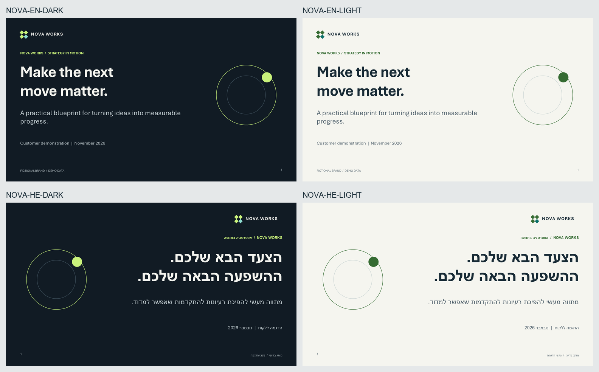

# NOVA deck designer

Custom skills that create **new, editable PPTX files**
from four bundled NOVA WORKS templates: English or Hebrew, dark or light.
NOVA WORKS is an original fictional demo brand; all sample figures are synthetic.

**Created by [Ofir Gavish](https://github.com/OfirGavish).**



## Choose a variant

| Variant | Intended use | Package |
|---|---|---|
| `nova-deck-designer` | Copilot in PowerPoint; original folder-install workflow | `dist\nova-deck-designer.zip` or the source skill folder |
| `bilingual-multi-template-deck-builder` | Cowork, Copilot Studio Microsoft Copilot-harness agents, and Scout with supported native-template tools or Python, plus file output | `dist\bilingual-multi-template-deck-builder.zip` or its generated unpacked folder |

Both use **one shared renderer, binding manifest and set of four templates**.
The portable ZIP contains the decks, scripts, examples and host guidance; no
extra template attachment is required in a capable runtime. Target-host import,
execution and delivery are only partially verified, not cross-host certified.
See the [portable build and installation guide](docs/PORTABLE.md).

## Install in PowerPoint

1. In PowerPoint Copilot, open **Settings (…) → Manage skills → Custom skills**.
2. Select **Create OneDrive folder** if needed, then **Open skills folder**.
3. Copy the whole **`nova-deck-designer`** folder from this repository into that
   skills folder. Do not copy the repository or only `SKILL.md`.
4. Wait for OneDrive sync, select **Refresh**, then start a **new chat** to avoid
   cached instructions.

The folder name and `SKILL.md` frontmatter name must both be `nova-deck-designer`.
See [installation and troubleshooting](docs/INSTALLATION.md) for runtime
requirements, updates, and optional ZIP packaging.
Microsoft documents the [PowerPoint skills folder installation workflow](https://support.microsoft.com/en-us/powerpoint/copilot/copilot-in-powerpoint-skills).

## First prompt

Copy this into a new PowerPoint Copilot chat:

```text
Use the nova-deck-designer skill. First ask me whether to use English or Hebrew,
then ask whether to use the dark or light theme. Ask for my topic, audience, and
source facts if needed.

Create a NEW editable six-slide NOVA WORKS presentation using the selected
bundled template: cover, three-card agenda, three priorities, roadmap, decision
table, and closing. Use my facts only; do not invent metrics, results, dates, or
commitments. Label proposed actions as proposals.

Use the bundled direct PPTX builder, actually run its read-only --probe, and
check the generated file. Return the actual editable PPTX through the host's
file-artifact output, not a local path. Do not claim the current canvas changed.
If execution, dependencies, or file publication are unavailable, state the
exact blocker and explain an explicit attachment/open-copy fallback instead
of claiming automatic success.
```

## How it works

`nova-deck-designer` is the **PowerPoint-specific installable skill folder**:

```text
nova-deck-designer\
  SKILL.md
  assets\templates\
    NOVA-EN-DARK.pptx
    NOVA-EN-LIGHT.pptx
    NOVA-HE-DARK.pptx
    NOVA-HE-LIGHT.pptx
  references\
    templates.json
    content-format.md
  scripts\
    build_presentation.py
    inspect_template.py
```

The builder opens the selected **local PPTX**, clones its reference slide
compositions, and updates mapped editable text, charts, and tables. It preserves
masters, layouts, themes, font parts, and retained media; repeated charts receive
independent chart and workbook parts. Original templates are never overwritten.
Source speaker instructions are removed unless supplied in the plan's notes.

**Local skill paths are not chat attachments.** Do not pass a local path or
`file://` URL to an attachment-only template import tool. No cloud template
URLs or extra connectors are required. The result remains a local file until
the host actually publishes it as an artifact; generation does not automatically
change the open PowerPoint canvas.

## PowerPoint-specific compatibility

These requirements apply to the original `nova-deck-designer` workflow.
The portable variant additionally supports a capability-gated native route;
see [PORTABLE.md](docs/PORTABLE.md).

- The runtime must **already provide** Python, the runtime dependencies, code
  execution, local asset access, and actual artifact/file output. A skill grants
  none of these capabilities. Do not install packages inside a Copilot sandbox.
- This direct-builder approach was confirmed in one desktop PowerPoint setup.
  The public NOVA adaptation is locally validated, **not universally
  runtime-certified**. Client capabilities and skill availability can vary.
- Hebrew uses RTL text and authored right-to-left layouts, not mirrored logos.
  Check mixed Hebrew/English text and slide overflow in the intended host.
- Aptos, Aptos Display, and Arial are referenced; no font binaries are shipped.
  Hosts may substitute fonts.
- Charts currently require a native category chart with a value axis. Tables
  must exactly match their reference dimensions; see the
  [custom template guide](docs/CUSTOM_TEMPLATES.md) for replacement-deck limits.

## Local development quickstart

Run these commands from the repository root in your own local Python
environment, not in a Copilot sandbox:

```powershell
python -m pip install -r requirements-dev.txt
python nova-deck-designer\scripts\build_presentation.py --probe
New-Item -ItemType Directory -Force outputs | Out-Null
python nova-deck-designer\scripts\build_presentation.py --template en-light --content examples\pilot-en.json --output outputs\pilot.pptx
python -m unittest discover -s tests -v
python tools\package_skill.py --variant all
```

The read-only probe must actually run; its result does not prove that a host can
publish artifacts. Output must be a new `.pptx` in an existing, host-approved
directory outside the skill folder. Existing output files are refused: choose
a new output name when rerunning. Runtime dependencies are `python-pptx>=1.0.2,<2`,
`defusedxml>=0.7.1,<1`, and `lxml>=4.9,<7` (see `requirements.txt`).
Local packaging additionally uses PyYAML from `requirements-dev.txt` to reject
invalid skill frontmatter before distributing a package. PyYAML is not a
requirement of the hosted presentation-generation script.

Template keys are `en-dark`, `en-light`, `he-dark`, and `he-light`.
`examples\pilot-en.json` and `examples\pilot-he.json` contain six-slide plans;
`examples\all-layouts-en.json` and `examples\all-layouts-he.json` exercise all
eight layouts. See the [content contract](nova-deck-designer/references/content-format.md)
and [custom template guide](docs/CUSTOM_TEMPLATES.md) before changing bindings.

The default `python tools\package_skill.py` still builds only the original
PowerPoint ZIP with its observed size guards. `--variant portable` builds the
root-level portable ZIP, complete unpacked skill, separately licensed MIT CAT submission
and a checksum/size receipt under `dist`. Do not install the partial authoring
overlay under `variants` directly. See [PORTABLE.md](docs/PORTABLE.md).

## License and reuse

The original repository and ordinary PowerPoint/portable ZIPs retain the custom
license below. The **separate, author-approved CAT edition** is generated under
`dist\cat\submissions\bilingual-multi-template-deck-builder` using the standard
[MIT terms](editions/cat-mit/LICENSE.txt). It retains Ofir Gavish's copyright
notice and visible creator credit, but has no additional README/project-page
credit condition. This does not relicense the original distributions.
See [CAT edition details](docs/PORTABLE.md#author-approved-mit-cat-edition).

The [NOVA Skill Attribution License 1.0](LICENSE) is a **custom permissive
attribution license**, not standard MIT or an OSI-approved license.
It permits use, modification, commercial use, and redistribution subject to
its conditions.

If you republish the skill, a modified version, a packaged copy, or a
substantial portion, you must retain the copyright and license and include
reasonably visible creator credit in your README or primary project page:

> Originally created by Ofir Gavish.

Equivalent clear wording is acceptable. A dedicated Credits section is enough;
you may also credit your own contributors and modifications.
See [attribution guidance](ATTRIBUTION.md) and the full license.

**Ordinary finished presentations do not need creator credit.** The output
exception does not cover redistribution as reusable skills or template packages.
Third-party fonts, Microsoft Office, trademarks, and independently authored
replacement materials retain their own rights.

Repository: [OfirGavish/copilot-powerpoint-template-skill](https://github.com/OfirGavish/copilot-powerpoint-template-skill).
